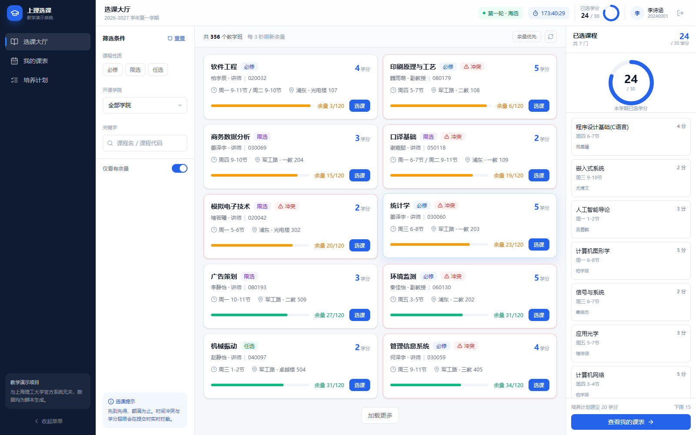
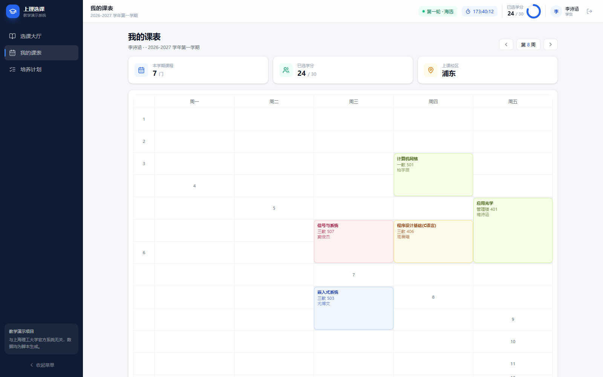
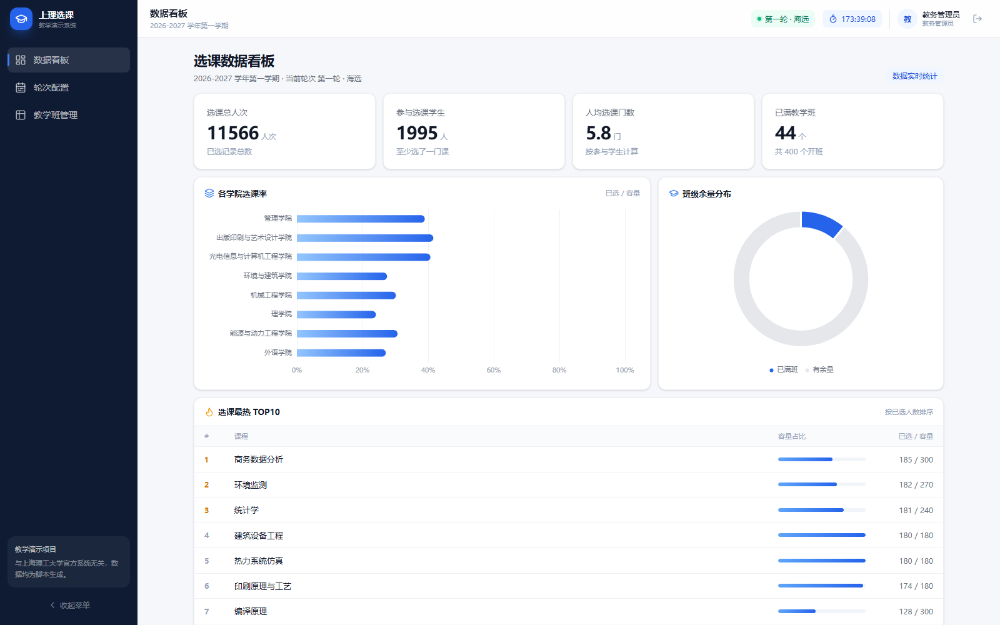

# 高校选课系统（教学演示）

对标上海理工大学教务选课系统的课程设计项目：学生端完成三轮选课、课表与培养计划，管理端完成轮次配置、教学班维护与选课统计。**课程设计定位，非官方系统。**



## 功能

**学生端**

- 选课大厅：性质 / 学院 / 余量 / 关键字筛选，课程卡实时余量，右侧已选清单与学分环形进度
- 选课校验：轮次窗口、重复选课、名额已满、学分超限、时间冲突、先修未过、跨年级，全部返回中文原因
- 退课：按轮次与课程性质限制，必修课不可退
- 我的课表：周五天 × 12 节网格，同课同色，冲突并排，单双周显隐
- 培养计划：按学期展示应修 / 已完成 / 未通过，学分进度对比毕业要求

**管理端**

- 数据看板：选课人次、平均门数、满班数、各学院选课率、热门课程 TOP10
- 轮次配置：三轮起止时间、允许退课开关、名单锁定
- 教学班管理：新增 / 编辑 / 停开、实时已选人数、余量预警、名单导出（CSV，Excel 可直接打开）

| 我的课表 | 数据看板 |
|---|---|
|  |  |

## 技术栈

| 层 | 选型 |
|---|---|
| 后端 | Spring Boot 3.2 · JDK 17 · MyBatis-Plus 3.5 · MySQL 8 · JWT + 拦截器 · springdoc-openapi |
| 前端 | Vue 3.4 · TypeScript · Vite 5 · TDesign Vue Next · Pinia · ECharts · Tailwind CSS |
| 数据 | 16 张表 / 22 个接口 / 7 个页面，`scripts/gen_seed.py` 生成 2000 学生、400 教学班 |

## 目录结构

```text
backend/            Spring Boot 单体：controller / service / mapper / security
frontend/           Vue 3 SPA：views（7 页）/ components / api / stores
db/                 schema.sql（建表）、seed.sql（种子数据，约 1.1 MB）
scripts/            gen_seed.py 造数、concurrent_test.py 并发压测
docs/               需求、数据库设计、接口文档、演示脚本、并发验证、部署指南
deploy/             nginx.conf、systemd 服务单元、环境变量模板
```

## 本地运行

前置：JDK 17、Maven 3.9、MySQL 8、Node.js 20+。

```bash
# 1. 初始化数据库
mysql -uroot -p -e "CREATE DATABASE course_selection DEFAULT CHARSET utf8mb4;"
mysql -uroot -p course_selection < db/schema.sql
mysql -uroot -p course_selection < db/seed.sql

# 2. 后端（默认连 localhost:3306，root 空密码；密码用环境变量覆盖）
cd backend
mvn spring-boot:run
# Windows PowerShell：$env:MYSQL_PASSWORD="你的密码"; mvn spring-boot:run

# 3. 前端
cd frontend
npm install
npm run dev          # http://localhost:5173，已配置 /api 代理到 8080
```

演示账号：学生 `20240001 / 123456`，管理员 `admin / 123456`。接口文档 `http://localhost:8080/swagger-ui/index.html`。

## 核心设计

1. **不超卖的兜底是一条 SQL**：`UPDATE teaching_class SET selected_count = selected_count + 1 WHERE id = ? AND status = 'OPEN' AND selected_count < capacity`，影响行数为 0 即已满，直接回滚。InnoDB 行锁让同一教学班的并发天然串行化。
2. **幂等**：请求头 `Idempotency-Key` 落 `enrollment_log` 唯一索引，重放返回首次结果；`enrollment.status_flag` 生成列做部分唯一索引，退课后可重选。
3. **时间冲突 O(1)**：`time_bitmap` 用 BIGINT 存周 1-5 × 12 节共 60 位，冲突判断是一次与运算，与已选课程数无关。
4. **事务边界**：选课用 `TransactionTemplate` 显式控制，失败日志在回滚、连接归还之后再写，避免"持锁等连接"拖垮连接池（详见 `docs/05-并发验证记录.md`）。

## 验证

```bash
python scripts/concurrent_test.py --class-id 401 --threads 30
```

30 并发抢 1 个名额：`耗时 0.28s`、成功 1、`40002` 28、`selected_count == 记录数 == 1`，判定 `[PASS] 无超卖，数据一致`。

## 部署

服务器（Ubuntu + JDK 17 + MySQL 8 + Nginx + systemd）完整步骤见 [docs/06-部署指南.md](docs/06-部署指南.md)，配套文件在 `deploy/`。

## 文档

| 文件 | 内容 |
|---|---|
| `docs/01-需求分析.md` | 角色、用例、验收标准 |
| `docs/02-数据库设计.md` | 16 张表结构与关键索引 |
| `docs/03-接口文档.md` | 接口清单与错误码 |
| `docs/04-演示脚本.md` | 5 分钟答辩流程 |
| `docs/05-并发验证记录.md` | 死锁根因、修复与实测数据 |
| `docs/06-部署指南.md` | GitHub 上传与云服务器部署 |
